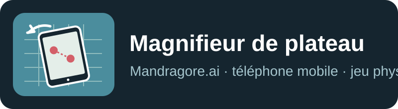
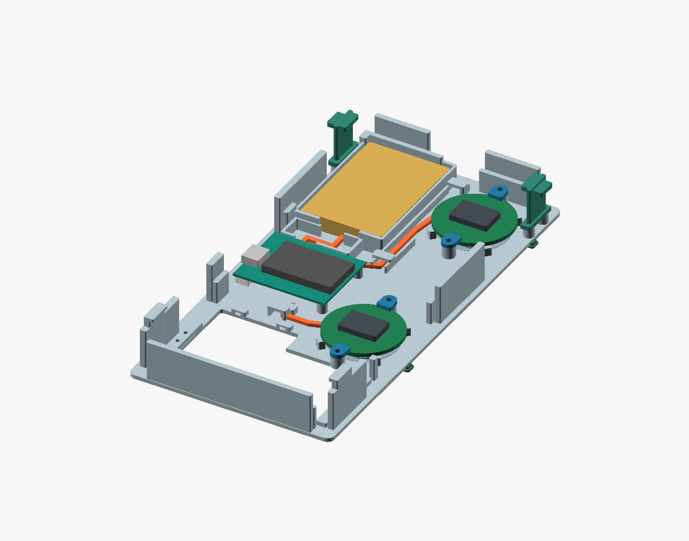

# Magnifieur de plateau

**Mandragore.ai — 500 Nuances de Geek** · [mandragore.ai](https://mandragore.ai) · [Maitresinh@500nuancesdegeek.fr](mailto:Maitresinh@500nuancesdegeek.fr)

## Cas d'usage

Sur un plateau physique dégagé, comme celui de *Horizon Forbidden West: The Board Game* (HF4A), un téléphone glisse à la surface et devient une fenêtre mobile sur le jeu. Le joueur peut poser des figurines sur l'écran du téléphone. Si la position et l'orientation du téléphone sont connues, et si les contacts des figurines sont détectés, l'application peut reporter leur position dans les coordonnées du plateau.

Au lieu de remplacer le plateau, le téléphone peut afficher **sur le lieu où il se trouve** une animation, une zone de déplacement, des informations sur une case, un combat ou une aide de règles. Le même principe peut servir à explorer une carte imprimée, inspecter une zone ou faire apparaître une couche de jeu contextuelle. Les figurines doivent tenir sur la surface utile de l'écran ; le suivi des pièces restées ailleurs sur le plateau demande un autre dispositif.

Ce dépôt documente le **concept, les essais déjà réalisés et un prototype mécanique en cours**. Il ne revendique pas encore une précision en millimètres ni un suivi fiable sur un plateau complet.

## Principe retenu pour le prototype

1. **Deux capteurs optiques sous le téléphone** mesurent le déplacement relatif sur le plateau. Leur séparation permet en principe de distinguer translation et rotation, sous réserve d'une calibration mécanique et d'essais physiques.
2. Un microcontrôleur **LilyGo T7-S3** lit les capteurs et transmet les mesures à l'application. Le protocole et son intégration dans Mandragore restent à développer.
3. Une **mise en correspondance visuelle ou manuelle** rattache périodiquement le mouvement relatif aux coordonnées absolues du plateau, en particulier après un soulèvement ou une perte de suivi.
4. L'application transforme les coordonnées tactiles des figurines sur l'écran en coordonnées du plateau. La détection et l'identité de ces figurines sont un chantier distinct ; ce dépôt ne promet pas une reconnaissance passive des socles.

Le support **R09 pour Galaxy A13 SM-A137F/DSN** est le candidat mécanique actuel. Il loge nominalement deux modules optiques ronds de 32 mm, séparés de 82 mm, la LilyGo et une batterie sous le téléphone. Son dessous laisse environ 12 mm entre le plateau et le dos du téléphone. Les [fichiers de fabrication et leur notice](prototype/R09/LIRE-AVANT-IMPRESSION.html) sont ici pour réaliser d'abord les quatre coupons d'ajustement. Les maillages ont été vérifiés numériquement ; **le montage, l'optique, l'électronique et la tenue réelle ne sont pas validés**.

## Ce que montrent les essais

| Approche | Résultat observé | Limite pour le produit |
|---|---|---|
| Caméra arrière seule, vidéo A13 d'environ 30 s | Position estimée sur **495/901 transitions (54,9 %)** avec mémoire et reprise locale ; retour à la zone initiale retrouvé à 29 s avec 67 correspondances SIFT | Disponibilité sur **la même vidéo utilisée pour ajuster l'algorithme**, pas une mesure d'erreur physique ni une validation sur d'autres plateaux |
| Caméra sur trois décors de test, texture + lignes | Position conservée sur **22,6 %** (grille vierge), **79,7 %** (décor), **98,2 %** (décor avec microcodes) | La forte disponibilité peut masquer une dérive : écart d'environ 1 612 pixels et 35° dans un passage du décor codé ; ni précision en mm ni essai aveugle |
| Caméra sur extrait de plateau HF4A | Onze positions globales confirmées sur 186 images dans un essai ; correspondance visuelle ponctuelle possible | 156 images sans position ; pas de suivi continu suffisant |
| IMU du téléphone seule | Prototype logiciel de déplacement et d'arrêt | Intégration de l'accélération sujette à la dérive ; précision physique non établie |
| Deux capteurs optiques + recalage | Architecture choisie pour le prochain essai | **Hypothèse de conception** : aucune trace PMW physique n'a encore validé l'exactitude sur le plateau cible |

Les pourcentages expriment une **disponibilité de sortie algorithmique**, jamais un taux de localisation correcte. Les conditions, fichiers sources et critères du prochain essai sont détaillés dans [État de la recherche](docs/etat-recherche.md) et [Plan de validation](docs/plan-validation.md).

## Prix et alternatives

L'[estimation datée du 7 novembre 2026](docs/couts-et-alternatives.md) distingue les prix vérifiés et les pièces encore sans devis. Un assemblage indicatif avec **deux cartes PMW complètes de comparaison**, la LilyGo et la batterie représente **68,77 $ + 5,65 € HT**, avant impression, visserie, fils, livraison, taxes et téléphone. Les cartes de comparaison sont **en rupture de stock et n'ont pas le format rond du R09** ; la LilyGo est aussi affichée en rupture. Cette somme n'est pas un devis de fabrication du prototype. Le prix des modules ronds exacts et le coût imprimé restent à obtenir.

La caméra seule, l'IMU, une souris fixée au téléphone, les repères imprimés et la calibration manuelle restent des solutions de comparaison. Nous retenons les deux capteurs optiques comme **direction expérimentale**, car le suivi caméra seul a présenté des pertes et une dérive. Le recalage visuel ponctuel peut compléter l'optique ; il n'est pas une preuve de précision tant que la fusion n'a pas été testée.

## Droits et réutilisation

Ce dépôt publie uniquement nos textes, plans, maillages et images CAO originales. Il **ne contient ni graphisme, carte, photo ou vidéo du jeu HF4A**, ni copie de règles ou de contenu propriétaire. Le nom du jeu décrit un cas d'essai et n'implique aucune affiliation. Les droits sur les visuels de plateaux et sur les applications commerciales doivent être examinés jeu par jeu. Voir [Droits, marques et données](docs/droits-et-donnees.md).

Nos contributions sont sous **[CC BY-NC 4.0](LICENSE.md)** : partage et adaptation non commerciaux avec attribution. Cette licence ne couvre pas les composants, fichiers ou droits de tiers. Pour un usage commercial ou si vous poursuivez le développement, contactez-nous : nous souhaitons aussi recueillir vos données d'essai (matériel, plateau, trajets et erreurs) afin de comparer les solutions.

## Fichiers

- [R09 : notice, source OpenSCAD, STL, coupons, vues et validation](prototype/R09/LIRE-AVANT-IMPRESSION.html)
- [État de la recherche](docs/etat-recherche.md)
- [Coûts et alternatives](docs/couts-et-alternatives.md)
- [Plan de validation du prototype](docs/plan-validation.md)
- [Droits et données](docs/droits-et-donnees.md)
- [Citer ce dépôt](CITATION.cff)
